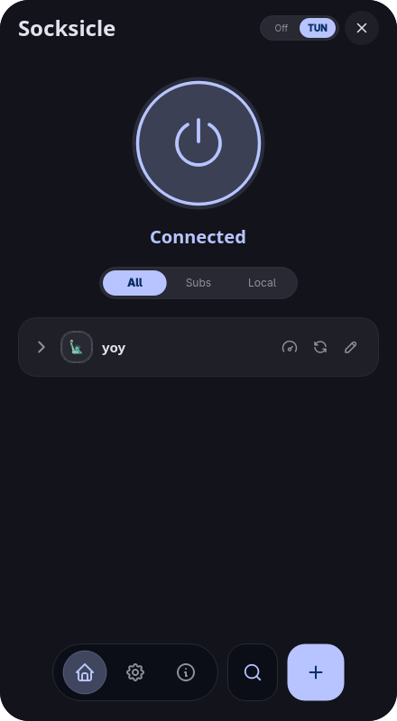
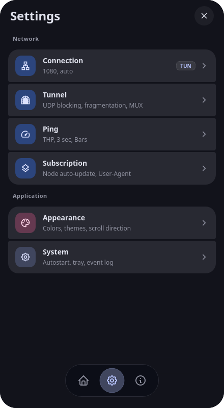
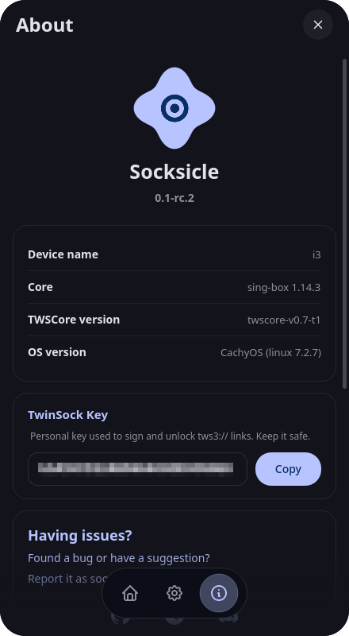

# Socksicle

[English](README.md) | [Русский](README_ru.md) | [简体中文](README_zh.md)

Socksicle is a desktop proxy client for Windows and Linux with a Material 3 interface. It configures and manages standalone proxy cores ([sing-box](https://github.com/SPlayer/sing-box) and [Xray-core](https://github.com/XTLS/Xray-core)), routing traffic through a local SOCKS5 proxy or a system-wide TUN adapter.

> **Status:** Early development (`0.1.1`). Expect bugs and breaking changes.

| Main | Settings | About |
|:---:|:---:|:---:|
|  |  |  |

## Features

- **Protocols:** Shadowsocks, VLESS, VMess, Hysteria 2, Trojan, and TUIC.
- **Engines:** Automatic selection between `sing-box` and `Xray`, or manual override per profile.
- **Routing modes:** Local SOCKS5 proxy (`127.0.0.1:1080` by default) or system-wide TUN.
- **Subscriptions:** Import from HTTPS URLs (plain text, Base64, or SIP008 JSON) with auto-updates.
- **Protection:** Built-in Kill Switch (Windows Firewall / Linux nftables) and SSRF-safe subscription fetching.
- **Latency testing:** Real-time TCP handshake and HTTP latency checks.
- **Design:** Modern Material 3 UI with dark/light themes and tray support.

## Protocol Support

| Protocol | Engine | Notes |
|---|---|---|
| **Shadowsocks** | sing-box, Xray | SIP003 plugins are parsed but not forwarded to cores |
| **VLESS** | sing-box, Xray | XHTTP transport requires Xray |
| **VMess** | sing-box, Xray | TCP, WebSocket, gRPC |
| **Hysteria 2** | sing-box | Requires both obfs type and password if obfs is enabled |
| **Trojan** | sing-box | Standard TLS transport |
| **TUIC** | sing-box | TUIC v5 |

Accepted link formats:
```text
ss://  vless://  vmess://  hysteria2://  hy2://  trojan://  trojan-go://  tuic://  tws3://
```

## Installation

Download prebuilt packages from [GitHub Releases](https://github.com/Socksicle/desktop/releases).

### Linux

- **One-line install (Recommended):**
  ```bash
  curl -fsSL https://iwtsd.online/socksicle/get | bash
  ```

- **Manual Download:**
  Download the AppImage or `.tar.xz` archive from releases:
  ```bash
  # AppImage:
  chmod +x Socksicle-<version>-x86_64.AppImage
  ./Socksicle-<version>-x86_64.AppImage

  # Or extract tar.xz:
  tar -xf Socksicle-<version>-Linux-x86_64.tar.xz
  ./Socksicle/socksicle
  ```

### Windows

- **Installer:** Run `Socksicle-Setup-<version>-x64.exe`.
- **Portable:** Extract `Socksicle-<version>-Windows-Portable-x64.zip` and run `Socksicle.exe`.

### Release Editions & Archive Types

Every release is published in three editions depending on the bundled proxy cores:

| Edition | Bundled Cores | Best For |
|---|---|---|
| **Standard** *(default)* | `sing-box` (+ `wintun.dll` on Windows) | Most users. Ready out of the box with optimal resource usage. |
| **With Xray** (`With-Xray`) | `sing-box` + `Xray-core` (+ geo-databases) | Full protocol support, including VLESS XHTTP and Xray-specific features. |
| **Coreless** (`Coreless`) | *None* | Minimal package size (~20 MB). Uses cores from your system `PATH` or placed manually in `bin/`. |

#### File Formats:
- **Windows:**
  - `Socksicle-Setup-*.exe` — Installer with desktop shortcuts and uninstaller.
  - `Socksicle-*-Windows-Portable-*.zip` — Standalone portable folder, no installation required.
- **Linux:**
  - `Socksicle-*.AppImage` — Self-contained single-file executable for any modern Linux distribution.
  - `Socksicle-*.tar.xz` — Portable archive containing the binary, libraries, and desktop entry.

## Quick Start

1. **Add a server:** Click **Add** and paste a node link (`vless://`, `ss://`, etc.) or import a subscription URL.
2. **Choose mode:**
   - **SOCKS5 (default):** Configure your browser or apps to use `127.0.0.1:1080`.
   - **TUN:** Routes all system traffic through the proxy.
3. **Connect:** Click the power button.

> **TUN Requirements:**
> - **Windows:** Requires Administrator privileges and `wintun.dll` placed next to `sing-box.exe`.
> - **Linux:** Requires `pkexec` (Polkit) for network configuration permissions.

## Running from Source

Requirements: Python 3.10+ and external core binaries.

```bash
# Clone repository
git clone https://github.com/socksicle/desktop.git
cd desktop

# Setup virtual environment
python -m venv .venv
source .venv/bin/activate       # Windows: .venv\Scripts\Activate.ps1

# Install dependencies
pip install -e ".[dev]"

# Run
python main.py
```

### Core Binaries

When running from source, download the cores and place them in `bin/` or in your system `PATH`:

```text
bin/
├── singbox/
│   ├── sing-box          # Linux
│   ├── sing-box.exe      # Windows (requires sing-box >= 1.14)
│   └── wintun.dll        # Windows (required for TUN)
└── xray/
    ├── xray              # Linux
    └── xray.exe          # Windows
```

CLI flags:
- `--minimized`: Start minimized to the system tray.
- `--debug`: Enable verbose core logs.

## Configuration & Logs

| OS | Config Directory | Log Directory |
|---|---|---|
| **Windows** | `%APPDATA%\socksicle\` | `%LOCALAPPDATA%\socksicle\logs\` |
| **Linux** | `~/.config/socksicle/` | `~/.config/socksicle/logs/` |

Settings, servers, and subscriptions are stored as plain JSON in the config directory. Sensitive fields (passwords, UUIDs, private keys) are encrypted with AES-256-GCM before saving to disk.

## Known Limitations

- **TUN & Kill Switch:** Both features are currently in beta. If the app crashes ungracefully, network routes or firewall rules may need to be cleared manually or reset by reopening Socksicle.
- **Xray DoT:** Xray does not support DNS-over-TLS (`tls://`). Use DNS-over-HTTPS (`https://`) or switch to sing-box if DoT is required.
- **macOS:** Not supported.

## Community & Feedback

- Issues & Bug Reports: [GitHub Issues](https://github.com/Socksicle/desktop/issues)
- News & Updates: Telegram [@iwtsddev](https://t.me/iwtsddev)

## License

[MIT](LICENSE). `sing-box` and `Xray-core` are separate projects licensed under their own respective terms.
